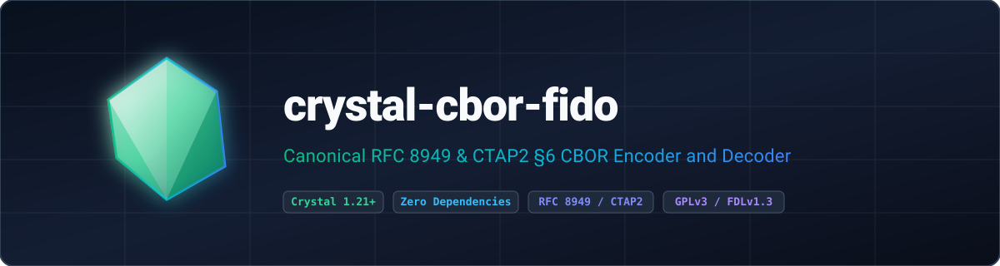

<p align="center">
  
</p>

<p align="center">
  <strong>Memory-safe, zero-dependency Canonical CBOR (RFC 8949 §4.2 and CTAP2 §6) encoder and decoder for Crystal with IEEE 754 float narrowing and strict validation.</strong>
</p>

<p align="center">
  <a href="https://gitlab.com/renich/crystal-cbor-fido/-/releases"></a>
  <a href="https://crystal-lang.org/">= 1.21.0" /></a>
  <a href="https://gitlab.com/renich/crystal-cbor-fido/-/pipelines"></a>
  <a href="https://gitlab.com/renich/crystal-cbor-fido"></a>
  <a href="https://github.com/crystal-ameba/ameba"></a>
  <a href="https://github.com/kdairatchi/flaw"></a>
</p>

<p align="center">
  <a href="https://renich.gitlab.io/crystal-cbor-fido/"></a>
  <a href="https://renich.gitlab.io/crystal-cbor-fido/technical/api/"></a>
  <a href="LICENSE"></a>
  <a href="https://liberapay.com/Renich/donate"></a>
</p>

> **GitLab Project Metadata**:
> - **Description**: Memory-safe Canonical CBOR (RFC 8949 §4.2 and CTAP2 §6) encoder and decoder for Crystal with IEEE 754 float narrowing and strict validation.
> - **Topics and Tags**: `crystal`, `crystal-lang`, `cbor`, `fido2`, `ctap2`, `webauthn`, `rfc8949`, `serialization`, `security`, `gplv3`

---

## Overview

**crystal-cbor-fido** provides a deterministic, zero-dependency, and hardened **Canonical CBOR** (RFC 8949 §4.2 and FIDO2 CTAP2 §6) encoder and decoder for [Crystal](https://crystal-lang.org/), purpose-built for FIDO2, WebAuthn, and COSE protocol compliance.

### Key Highlights

1. **Strict Canonical CBOR Compliance**: Enforces minimal integer and floating-point widths, deterministic CTAP2 map key ordering (shorter byte length first, then unsigned byte-wise lexicographical order), duplicate serialized key rejection on both encode and decode, and top-level trailing-byte rejection.
2. **Compile-Time `CBOR::Serializable` Macro**: Zero-boilerplate struct and class serialization via `include CBOR::Serializable`, `@[CBOR::Field(key: ..., ignore: ...)]`, and `@[CBOR::Serializable::Options(strict: Bool = true)]` supporting integer COSE labels (`1`, `3`, `-1`, `-2`, `-3`) and UTF-8 string keys.
3. **IEEE 754 Half-Precision (`Float16`) Narrowing**: Lossless `Float64 -> Float32 -> Float16` narrowing with exact subnormal precision ($1 \times 2^{-24} \approx 5.96 \times 10^{-8}$), round-to-nearest-even bit manipulation with guard and sticky bit inspection, canonical `0x7e00` `NaN`, and `+0.0` `0x0000` normalization.
4. **Bounded Streaming `IO` & Defensive Resource Limits**: Supports direct `IO` streaming with configurable `max_depth : Int32 = 16`, `max_bytes : UInt64 = 1_048_576_u64` (bounded by `MAX_LEN = 10_000_000_u64`), and `eof_check : Bool = true`, verified against the RFC 8949 Appendix A test vector corpus.

---

## Installation

Add `crystal-cbor-fido` to your application's `shard.yml`:

```yaml
dependencies:
  crystal-cbor-fido:
    gitlab: renich/crystal-cbor-fido
    version: ~> 0.2.2
```

Then install the shard:

```bash
shards install
```

---

## Usage

```crystal
require "crystal-cbor-fido"

# 1. Strongly-typed FIDO2/COSE structs via CBOR::Serializable
struct CoseEc2Key
  include CBOR::Serializable

  @[CBOR::Field(key: 1_i64)]
  getter kty : Int64

  @[CBOR::Field(key: 3_i64)]
  getter alg : Int64

  @[CBOR::Field(key: -1_i64)]
  getter crv : Int64

  def initialize(@kty : Int64, @alg : Int64, @crv : Int64) : Nil
  end
end

key = CoseEc2Key.new(kty: 2_i64, alg: -7_i64, crv: 1_i64)
wire_bytes = key.to_cbor
restored = CoseEc2Key.from_cbor(wire_bytes)

# 2. Dynamic maps and bounded IO streaming
io = IO::Memory.new
Crystal::Cbor::Fido.encode({"rp_id" => "evalinux.com", "uv" => true} of CBOR::Value => CBOR::Value, io)
io.rewind
decoded_data = Crystal::Cbor::Fido.decode(io, max_bytes: 65_536_u64, eof_check: true)
puts "Decoded Data: #{decoded_data.inspect}"
```

---

## Build System Targets

The repository includes a standard `GNUmakefile`:

| Target | Description |
| :--- | :--- |
| `make all` | Runs `lint` (`crystal tool format --check`, Ameba, Flaw) and `test` (`crystal spec`) |
| `make check` | Alias for `test` target per GNU standards |
| `make test` | Executes the Crystal spec suite (`crystal spec`) |
| `make lint` | Runs `crystal tool format --check`, `bin/ameba --all`, and `bin/flaw scan .` |
| `make format` | Formats Crystal source and spec files (`crystal tool format src spec`) |
| `make doc-check` | Lints all reStructuredText files using `crstlint` and `rstcheck` |
| `make docs` | Generates Crystal API docs (`docs/technical/api`) and Sphinx `dirhtml` (`docs/build/dirhtml`) |
| `make deps` | Installs Shards dependencies and builds `bin/ameba` and `bin/flaw` |
| `make clean` | Removes generated documentation, linter binaries, and build artifacts |

---

## Documentation

Full architectural blueprints, functional specifications, D2 diagrams, and operational playbooks are maintained under [`docs/`](docs/index.rst):

| Guide | Scope & Highlights | Entry Point |
| :--- | :--- | :--- |
| **Business Context & Strategy** | FIDO2 ecosystem problem statement, ROI metrics, and personas. | [Business Specs](docs/business/spec.rst) |
| **Functional Specifications** | Requirements `[FUNC-001]`–`[FUNC-007]` and canonical contracts. | [Functional Specs](docs/functional/spec.rst) |
| **Technical Architecture** | Specs `[TECH-001]`–`[TECH-007]`, D2 architecture diagram, and threat model. | [Technical Specs](docs/technical/spec.rst) |
| **Release Playbook** | SemVer, Keep a Changelog, and GPG-signed GitLab release steps. | [Release Procedure](docs/technical/specs/release-procedure.rst) |
| **Architecture Decisions (ADRs)** | Immutable logs of architectural decisions (`ADR-001`, `ADR-002`). | [ADR Index](docs/adrs/index.rst) |
| **Project Roadmap** | Phased milestone tracking (`TASK-101`–`TASK-204`) and D2 dependency graphs. | [Project Roadmap](docs/project/roadmap.rst) |
| **User Documentation** | Installation, usage examples, and exception handling guide. | [Getting Started](docs/user/guides/getting-started.rst) |
| **Crystal API Reference** | Complete interactive type hierarchy and method signatures. | [API Reference](https://renich.gitlab.io/crystal-cbor-fido/technical/api/) |

---

## Contributing & Code of Honor

All contributions must adhere to the [Universal Code of Honor](CODE_OF_HONOR.rst) and [Contributing Guidelines](CONTRIBUTING.rst).

---

## License

- **Software**: GNU General Public License v3.0 or later ([LICENSE](LICENSE)).
- **Documentation**: GNU Free Documentation License v1.3 or later ([LICENSE-DOCS](LICENSE-DOCS)).

Copyleft &copy; 2026 Rénich Bon Ćirić &lt;renich@evalinux.com&gt;.

---

## Support & Donations

If you find this shard useful and wish to support its ongoing development, please consider donating:

<p align="center">
  <a href="https://liberapay.com/Renich/donate">
    
  </a>
</p>
