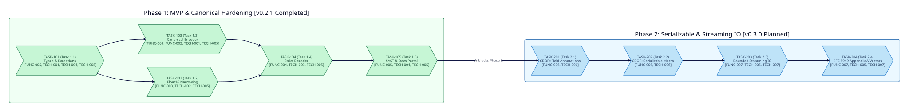

===============
Project Roadmap
===============

Overview
--------
This document tracks the sequenced phase milestones, atomic task dependency graphs, and bidirectional requirement traceability (``[FUNC-001]`` through ``[FUNC-007]`` and ``[TECH-001]`` through ``[TECH-007]``) for ``crystal-cbor-fido``.

Macro Dependency Graph
----------------------

Executive Phase Summary
-----------------------

.. list-table::
   :widths: 22 18 28 32
   :header-rows: 1

   * - Phase
     - Target Version
     - Status
     - Fulfilled Specifications
   * - :doc:`roadmaps/phase-1-mvp`
     - ``v0.2.1``
     - Completed
     - ``[FUNC-001]``..``[FUNC-005]``, ``[TECH-001]``..``[TECH-005]``
   * - :doc:`roadmaps/phase-2-enhancement`
     - ``v0.3.0``
     - Planned
     - ``[FUNC-006]``, ``[FUNC-007]``, ``[TECH-005]``..``[TECH-007]``

.. toctree::
   :maxdepth: 1
   :caption: Roadmap Phases

   roadmaps/phase-1-mvp
   roadmaps/phase-2-enhancement
   audits/index
