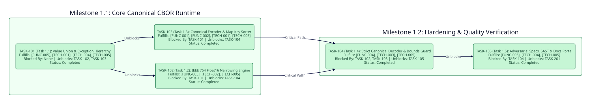

============
Phase 1: MVP
============

Timeline and Objectives
-----------------------
Deliver the core zero-dependency Crystal implementation of Canonical CBOR encoding and decoding per RFC 8949 Section 4.2 and FIDO2 CTAP2 Section 6 specification requirements (``v0.2.1`` Completed).

Phase 1 Dependency Graph
------------------------

Milestone 1.1: Core Canonical CBOR Runtime
------------------------------------------

TASK-101: Recursive Value Union and Exception Hierarchy
~~~~~~~~~~~~~~~~~~~~~~~~~~~~~~~~~~~~~~~~~~~~~~~~~~~~~~~

* **Status**: Completed (``v0.1.0``/``v0.2.1``)
* **Fulfills**: ``[FUNC-005]``, ``[TECH-001]``, ``[TECH-004]``, ``[TECH-005]``
* **Blocked By**: None
* **Unblocks**: ``TASK-102``, ``TASK-103``
* **Deliverable**: Implement ``src/crystal-cbor-fido/types.cr`` defining the recursive ``Crystal::Cbor::Fido::Value`` union alias and the structured exception hierarchy ``CborError``, ``CanonicalError``, and ``DepthError`` with zero external dependencies.

TASK-102: Lossless IEEE 754 Float16 Narrowing Engine
~~~~~~~~~~~~~~~~~~~~~~~~~~~~~~~~~~~~~~~~~~~~~~~~~~~~

* **Status**: Completed (``v0.1.2``/``v0.2.1``)
* **Fulfills**: ``[FUNC-003]``, ``[TECH-002]``, ``[TECH-005]``
* **Blocked By**: ``TASK-101``
* **Unblocks**: ``TASK-104``
* **Deliverable**: Implement ``src/crystal-cbor-fido/float16.cr`` and ``Crystal::Cbor::Fido.fits_in_float32_exactly?`` providing bit-level IEEE 754 ``Float64`` -> ``Float32`` -> ``Float16`` narrowing, exact :math:`1 \times 2^{-24}` subnormal scaling, round-to-nearest-even rounding, canonical ``NaN`` ``0x7e00``, and ``+0.0`` ``0x0000``.

TASK-103: Canonical Encoder and CTAP2 Map Key Sorter
~~~~~~~~~~~~~~~~~~~~~~~~~~~~~~~~~~~~~~~~~~~~~~~~~~~~

* **Status**: Completed (``v0.2.0``/``v0.2.1``)
* **Fulfills**: ``[FUNC-001]``, ``[FUNC-002]``, ``[TECH-001]``, ``[TECH-005]``
* **Blocked By**: ``TASK-101``
* **Unblocks**: ``TASK-104``
* **Deliverable**: Implement ``src/crystal-cbor-fido/encoder.cr`` enforcing shortest-length RFC 8949 Section 4.2 integer and container headers, ``MAX_DEPTH = 16`` nesting limits across containers and map keys, CTAP2 length-first then byte-wise lexicographical map key sorting, and duplicate serialized key rejection.

Milestone 1.2: Hardening, Build System and Quality Verification
---------------------------------------------------------------

TASK-104: Strict Canonical Decoder and Resource Bounds Guard
~~~~~~~~~~~~~~~~~~~~~~~~~~~~~~~~~~~~~~~~~~~~~~~~~~~~~~~~~~~~

* **Status**: Completed (``v0.2.0``/``v0.2.1``)
* **Fulfills**: ``[FUNC-004]``, ``[TECH-003]``, ``[TECH-005]``
* **Blocked By**: ``TASK-102``, ``TASK-103``
* **Unblocks**: ``TASK-105``
* **Deliverable**: Implement ``src/crystal-cbor-fido/decoder.cr`` and top-level ``Crystal::Cbor::Fido.decode`` enforcing minimal-width integer and float validation, ``Int128`` negative integer underflow protection, :math:`O(1)` streaming map key order verification, ``MAX_DEPTH = 16``, cumulative ``MAX_LEN = 10_000_000_u64`` allocation caps, and top-level trailing-byte rejection.

TASK-105: Adversarial Specs, Static Analysis and Documentation Portal
~~~~~~~~~~~~~~~~~~~~~~~~~~~~~~~~~~~~~~~~~~~~~~~~~~~~~~~~~~~~~~~~~~~~~

* **Status**: Completed (``v0.2.1``)
* **Fulfills**: ``[FUNC-005]``, ``[TECH-004]``, ``[TECH-005]``
* **Blocked By**: ``TASK-104``
* **Unblocks**: ``TASK-201`` (Phase 2)
* **Deliverable**: Deliver 39 deterministic unit and adversarial specs, zero-violation Ameba and Flaw SAST gates, standard ``GNUmakefile``, and the full Sphinx + Crystal API documentation portal.

Critical Path
-------------
``TASK-102`` and ``TASK-103`` execute in parallel once unblocked by ``TASK-101`` and both converge to unblock ``TASK-104``:

``TASK-101 -> (TASK-102, TASK-103) -> TASK-104 -> TASK-105``
