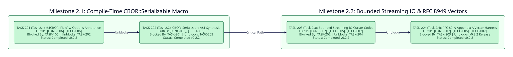

====================
Phase 2: Enhancement
====================

Timeline and Objectives
-----------------------
Extend ``crystal-cbor-fido`` in ``v0.2.2`` with compile-time ``CBOR::Serializable`` macro annotations for zero-boilerplate FIDO2/COSE struct and class serialization, bounded streaming ``IO`` codecs, and exhaustive RFC 8949 Appendix A test vector verification.

Phase 2 Dependency Graph
------------------------

Milestone 2.1: Compile-Time CBOR::Serializable Macro
----------------------------------------------------

TASK-201: CBOR::Field Annotation and Canonical Key Metadata
~~~~~~~~~~~~~~~~~~~~~~~~~~~~~~~~~~~~~~~~~~~~~~~~~~~~~~~~~~~

* **Status**: Completed (``v0.2.2``)
* **Fulfills**: ``[FUNC-006]``, ``[TECH-006]``
* **Blocked By**: ``TASK-105``
* **Unblocks**: ``TASK-202``
* **Deliverable**: Define the ``@[CBOR::Field(key: ..., ignore: ...)]`` and ``@[CBOR::Serializable::Options(strict: Bool = true)]`` annotations and compile-time key-serialization helpers supporting both integer COSE labels (``1``, ``3``, ``-1``, ``-2``, ``-3``) and UTF-8 string keys.

TASK-202: CBOR::Serializable AST Macro Synthesis
~~~~~~~~~~~~~~~~~~~~~~~~~~~~~~~~~~~~~~~~~~~~~~~~

* **Status**: Completed (``v0.2.2``)
* **Fulfills**: ``[FUNC-006]``, ``[TECH-006]``
* **Blocked By**: ``TASK-201``
* **Unblocks**: ``TASK-203``
* **Deliverable**: Implement the ``Crystal::Cbor::Fido::Serializable`` (``CBOR::Serializable``) module macro synthesizing ``#to_cbor`` and ``.from_cbor`` on Crystal structs and classes with pre-sorted CTAP2 canonical field emission, unconditional ``CanonicalError`` on duplicate CBOR map keys regardless of mode, and ``strict: Bool = true`` unknown-key handling.

Milestone 2.2: Bounded Streaming IO and RFC 8949 Appendix A Vectors
-------------------------------------------------------------------

TASK-203: Bounded Streaming IO Cursor Codec
~~~~~~~~~~~~~~~~~~~~~~~~~~~~~~~~~~~~~~~~~~~

* **Status**: Completed (``v0.2.2``)
* **Fulfills**: ``[FUNC-007]``, ``[TECH-005]``, ``[TECH-007]``
* **Blocked By**: ``TASK-202``
* **Unblocks**: ``TASK-204``
* **Deliverable**: Implement ``Encoder.encode(value, io : IO, max_depth : Int32 = MAX_DEPTH) : Nil`` and ``Decoder.decode(io : IO, max_depth : Int32 = MAX_DEPTH, max_bytes : UInt64 = 1_048_576_u64, eof_check : Bool = true) : Value`` where ``MAX_DEPTH = 16`` aligns with Phase 1 container depth limits, ``max_bytes = 1_048_576_u64`` enforces a 1 MiB default streaming budget bounded by ``MAX_LEN = 10_000_000_u64``, and ``eof_check`` controls single-frame EOF trailing-byte rejection versus multi-frame stream decoding.

TASK-204: RFC 8949 Appendix A Vector Conformance Suite
~~~~~~~~~~~~~~~~~~~~~~~~~~~~~~~~~~~~~~~~~~~~~~~~~~~~~~

* **Status**: Completed (``v0.2.2``)
* **Fulfills**: ``[FUNC-007]``, ``[TECH-005]``, ``[TECH-007]``
* **Blocked By**: ``TASK-203``
* **Unblocks**: ``v0.2.2`` Release
* **Deliverable**: Integrate the complete RFC 8949 Appendix A diagnostic vector corpus into ``spec/``, verifying bit-exact canonical encoding, strict decoding rejection of non-canonical vectors, and bounded streaming ``IO`` conformance.

Critical Path
-------------
The Phase 2 critical path follows the strict linear dependency chain:

``TASK-201 -> TASK-202 -> TASK-203 -> TASK-204``
