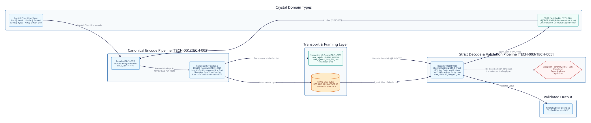

=====================
Architecture Overview
=====================

Requirement Mapping
-------------------
Fulfills ``[FUNC-001]``, ``[FUNC-002]``, ``[FUNC-003]``, ``[FUNC-004]``, ``[FUNC-005]``, ``[FUNC-006]``, ``[FUNC-007]``.

System Architecture Diagram
---------------------------

Library Layout and Namespaces
-----------------------------
The library source is organized under the ``Crystal::Cbor::Fido`` namespace with zero external runtime dependencies (``[FUNC-005]``):

* **``src/crystal-cbor-fido.cr``**: Top-level module entrypoint providing ``.encode``, ``.decode``, ``.compare_canonical_bytes``, and ``.fits_in_float32_exactly?``.
* **``src/crystal-cbor-fido/types.cr``**: Recursive ``Value`` union alias and domain exception hierarchy ``CborError``, ``CanonicalError``, and ``DepthError``.
* **``src/crystal-cbor-fido/float16.cr``**: IEEE 754 half-precision ``binary16`` bit manipulation, subnormal scaling (:math:`2^{-24}`), round-to-nearest-even rounding, and lossless representability checks.
* **``src/crystal-cbor-fido/encoder.cr``**: Deterministic Canonical CBOR serializer with ``MAX_DEPTH = 16`` enforcement and pre-serialized ``MapEntry`` key sorting.
* **``src/crystal-cbor-fido/decoder.cr``**: Strict Canonical CBOR deserializer with minimal-width verification, :math:`O(1)` streaming map key order checks, ``MAX_DEPTH = 16``, and cumulative ``MAX_LEN = 10_000_000_u64`` allocation accounting.

[TECH-001] Canonical Encoder and CTAP2 Map Key Sorting
------------------------------------------------------
Fulfills ``[FUNC-001]``, ``[FUNC-002]``, ``[FUNC-005]``.

Shortest-Length Header Serialization
~~~~~~~~~~~~~~~~~~~~~~~~~~~~~~~~~~~~
``Encoder#write_type_and_arg`` emits the 3-bit major type in the high bits of the initial byte and encodes the unsigned integer or length argument in the minimal RFC 8949 Section 4.2 width:

* Values ``0..23`` encode directly in the 5-bit additional information field.
* Values ``24..0xff`` emit additional information ``24`` followed by 1 big-endian byte.
* Values ``0x100..0xffff`` emit additional information ``25`` followed by 2 big-endian bytes.
* Values ``0x10000..0xffffffff`` emit additional information ``26`` followed by 4 big-endian bytes.
* Values ``0x100000000..0xffffffffffffffff`` emit additional information ``27`` followed by 8 big-endian bytes.

CTAP2 Canonical Map Ordering
~~~~~~~~~~~~~~~~~~~~~~~~~~~~
CTAP2 Section 6 mandates that map keys must be sorted by their canonical CBOR byte representation:

#. Shorter encoded byte length sorts before longer encoded byte length.
#. Keys with identical encoded byte lengths sort in unsigned byte-wise lexicographical order.
#. Duplicate serialized map keys are forbidden and must raise ``CanonicalError``.

.. code-block:: crystal

   module Crystal::Cbor::Fido
     def self.compare_canonical_bytes(a : Bytes, b : Bytes) : Int32
       cmp = a.size <=> b.size
       cmp != 0 ? cmp : (a <=> b)
     end
   end

[TECH-002] Lossless IEEE 754 Float16 Bit-Level Narrowing
--------------------------------------------------------
Fulfills ``[FUNC-003]``.

IEEE 754 Narrowest Representation
~~~~~~~~~~~~~~~~~~~~~~~~~~~~~~~~~
``Encoder#encode_float`` narrows every ``Float64`` scalar through the lossless hierarchy ``Float64`` -> ``Float32`` -> ``Float16``:

* Positive zero must encode as canonical ``Float16`` ``+0.0`` (``0x0000``, wire bytes ``0xf90000``), and negative zero must encode as ``-0.0`` (``0x8000``, wire bytes ``0xf98000``).
* All ``NaN`` values must normalize to the canonical quiet ``Float16`` bit pattern ``0x7e00`` (wire bytes ``0xf97e00``).
* Normalized and subnormal (:math:`1 \times 2^{-24}`) values convert via bit-level exponent re-biasing and round-to-nearest-even with guard and sticky bit inspection in ``Float16.from_float64``, verified by lossless round-trip comparison ``Float16.to_float64(bits) == value``.

.. code-block:: crystal

   private def encode_float(f : Float64) : Nil
     case
     when Float16.exactly_representable?(f)
       f16 = Float16.from_float64(f)
       @io.write_byte(0xf9_u8)
       @io.write_bytes(f16, IO::ByteFormat::BigEndian)
     when Crystal::Cbor::Fido.fits_in_float32_exactly?(f)
       @io.write_byte(0xfa_u8)
       @io.write_bytes(f.to_f32.unsafe_as(UInt32), IO::ByteFormat::BigEndian)
     else
       @io.write_byte(0xfb_u8)
       @io.write_bytes(f.unsafe_as(UInt64), IO::ByteFormat::BigEndian)
     end
   end

[TECH-003] Strict Canonical Decoder State Machine
-------------------------------------------------
Fulfills ``[FUNC-004]``.

Minimal-Width and Float Narrowing Verification
~~~~~~~~~~~~~~~~~~~~~~~~~~~~~~~~~~~~~~~~~~~~~~
``Decoder`` validates every incoming token before materializing Crystal values:

* Non-minimal integer or length headers (e.g., value ``< 24`` encoded with additional info ``24``) raise ``CanonicalError``.
* Negative integers (Major Type 1) decode via 128-bit signed intermediate arithmetic ``-1_i128 - val.to_i128`` and raise ``CborError`` if the result underflows ``Int64::MIN``.
* ``Float16`` values reject any ``NaN`` bit pattern other than ``0x7e00``.
* ``Float32`` values reject ``NaN`` and any value losslessly representable in ``Float16``.
* ``Float64`` values reject ``NaN`` and any value losslessly representable in ``Float16`` or ``Float32``.

Streaming Map Key Verification and Framing
~~~~~~~~~~~~~~~~~~~~~~~~~~~~~~~~~~~~~~~~~~
``Decoder`` verifies strictly ascending canonical map key ordering and duplicate key rejection in :math:`O(1)` auxiliary memory by comparing each decoded key's wire slice against the immediately preceding key's wire slice. Top-level ``Crystal::Cbor::Fido.decode`` verifies ``io.pos == bytes.size`` and raises ``CanonicalError`` if trailing bytes remain.

.. code-block:: crystal

   private def verify_key_order(prev : Bytes?, current : Bytes) : Nil
     return unless prev
     cmp = Crystal::Cbor::Fido.compare_canonical_bytes(prev, current)
     return if cmp < 0
     raise CanonicalError.new("Duplicate key in canonical CBOR map") if cmp == 0
     raise CanonicalError.new("Keys in canonical CBOR map are not in sorted order")
   end

[TECH-006] Compile-Time CBOR::Serializable AST Macro Architecture
-----------------------------------------------------------------
Fulfills ``[FUNC-006]``.

Declarative Struct and Class Mapping for v0.3.0
~~~~~~~~~~~~~~~~~~~~~~~~~~~~~~~~~~~~~~~~~~~~~~~
In Phase 2 ``v0.3.0``, ``Crystal::Cbor::Fido::Serializable`` (aliased as ``CBOR::Serializable``) will use Crystal compile-time AST macros (``macro included``, ``@[CBOR::Field]``, and ``@[CBOR::Serializable::Options(strict: Bool = true)]``) to synthesize zero-boilerplate ``#to_cbor(io : IO)``, ``#to_cbor : Bytes``, and ``.from_cbor(source : Bytes | IO)`` methods on domain structs and classes:

* ``@[CBOR::Field(key: 1_i64)]`` maps instance variables to integer COSE keys (e.g., ``kty: 1``, ``alg: 3``, ``crv: -1``, ``x: -2``, ``y: -3``) or string WebAuthn keys.
* ``@[CBOR::Field(ignore: true)]`` excludes transient instance variables from serialization and deserialization.
* During encoding, the macro emits fields into pre-sorted CTAP2 canonical key order so serialized maps satisfy RFC 8949 Section 4.2 without intermediate ``Hash(Value, Value)`` heap allocations.
* During decoding, the generated initializer unconditionally enforces strict CTAP2 canonical key ordering and unconditionally raises ``CanonicalError`` on duplicate CBOR map keys regardless of mode. ``@[CBOR::Serializable::Options(strict: Bool = true)]`` controls solely whether unknown/unmapped CBOR keys raise ``CborError`` (``strict: true``, default) or are skipped after canonical key-order validation (``strict: false``), while missing required fields or type mismatches always raise ``CborError``.

[TECH-007] Bounded Streaming IO Cursor Architecture
---------------------------------------------------
Fulfills ``[FUNC-007]``.

Streaming Encode and Decode with Configurable Guards for v0.3.0
~~~~~~~~~~~~~~~~~~~~~~~~~~~~~~~~~~~~~~~~~~~~~~~~~~~~~~~~~~~~~~~
In Phase 2 ``v0.3.0``, ``Encoder`` and ``Decoder`` will expose direct streaming ``IO`` class methods with explicit, caller-configurable resource bounds aligned with Phase 1 constants:

* ``Encoder.encode(value, io : IO, max_depth : Int32 = MAX_DEPTH) : Nil`` serializes ``Value`` or ``CBOR::Serializable`` instances directly into any target ``IO`` without intermediate top-level buffer copying, defaulting ``max_depth`` to ``MAX_DEPTH`` (``16``).
* ``Decoder.decode(io : IO, max_depth : Int32 = MAX_DEPTH, max_bytes : UInt64 = 1_048_576_u64, eof_check : Bool = true) : Value`` wraps the input stream in a byte-counting cursor that tracks exact bytes read alongside container nesting depth. ``max_depth`` defaults to ``MAX_DEPTH`` (``16``), and ``max_bytes`` defaults to ``1_048_576_u64`` (1 MiB streaming budget, capped by the absolute ceiling ``MAX_LEN = 10_000_000_u64``), raising ``DepthError`` when nesting exceeds ``max_depth`` and ``CborError`` when consumed or declared bytes exceed ``max_bytes``. When ``eof_check: true`` (default), the decoder verifies that the underlying ``IO`` has reached EOF after decoding a single top-level CBOR item and raises ``CanonicalError`` if trailing bytes remain; multi-frame stream callers pass ``eof_check: false`` to decode sequential frames from a persistent stream.
* The streaming codec will be verified against the full RFC 8949 Appendix A diagnostic test vector suite.
